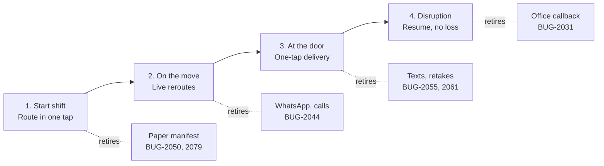

# Future State Journey: The Frontline Driver on RouteLogic Velocity

**Persona:** The Frontline Driver. A delivery driver who runs dozens of stops a day, often one-handed, outdoors and against the clock, on routes where the signal can't be counted on (UXR-01, UXR-06, UXR-11).

**Goal:** To get through each stop quickly and trust that the app will hold their route and record their work from the first stop to the last.

---

## Visual Timeline

The top row shows the Velocity future state. The bottom row shows the workaround each stage retires.

---

## The 4 Stages

1. **Start Shift**
   - **User Action:** Taps "Start Route" on the home screen → the full route is live in one tap.
   - **Internal State:** Starts without any backup prep → confident the route is cached offline.
   - **Pain Point Addressed:** Fixes the buried button and blank offline route (BUG-2079, 2050) → no screenshots or paper needed.

2. **On the Move**
   - **User Action:** Gets a push alert when dispatch reassigns → drives the correct route immediately.
   - **Internal State:** Follows the app instead of WhatsApp → trusts one source of instructions.
   - **Pain Point Addressed:** Removes the 8–15 minute reassignment lag (BUG-2044) → no miles wasted on stale routes.

3. **At the Doorstep**
   - **User Action:** One tap marks the stop delivered and queues the photo → done in seconds, one-handed.
   - **Internal State:** Sees an upload-confirmed tick → certain the proof is recorded, so no retakes.
   - **Pain Point Addressed:** Replaces the three-screen flow and silent upload failures (BUG-2055, 2061) → no texting the dispatcher.

4. **Through Disruption**
   - **User Action:** Reopens the app after a crash or dead zone → picks up at the next stop.
   - **Internal State:** Treats the disruption as a non-event → no phone call, no lost time.
   - **Pain Point Addressed:** Ends route loss on crash (BUG-2031) → recovers the "twenty minutes gone" per incident.

---

## Competitive Advantages Over the Manual Workaround

1. **Always current → backups go stale, Velocity stays live.** A paper manifest or screenshot is out of date after the first reassignment. Velocity keeps the latest route on the device, even offline.
2. **One record → feeds the reporting leadership bought.** Today, deliveries are spread across texts, WhatsApp and failed uploads. Capturing them once restores the admin reporting the Regional Manager called "why we bought it" (UXR-10).
3. **Zero overhead → no prep, callbacks or retakes.** The workaround costs time every day, even when nothing breaks. Velocity removes that cost.

---

## Things to Check Before Using This

- **The Value Prop names dispatchers, but this journey is the driver's.** It currently promises "dispatchers and fleet coordinators a fast, focused workspace." Stages 1, 3 and 4 depend on driver-side changes: offline caching, crash recovery and one-tap completion. Add drivers to the Value Prop, or the journey promises more than the initiative covers.
- **Velocity is more than decluttering.** "Stripping away legacy noise" covers stages 1 and 3. Stages 2 and 4 need stability and sync fixes. Framing Velocity as "fast *and* reliable" fits the revised hook better.
- **"Our largest account"** is still in the "why right now" section. Keep it only if CRM data confirms it.

Every stage above describes capability Velocity would have to deliver; none of it exists in the product today.
